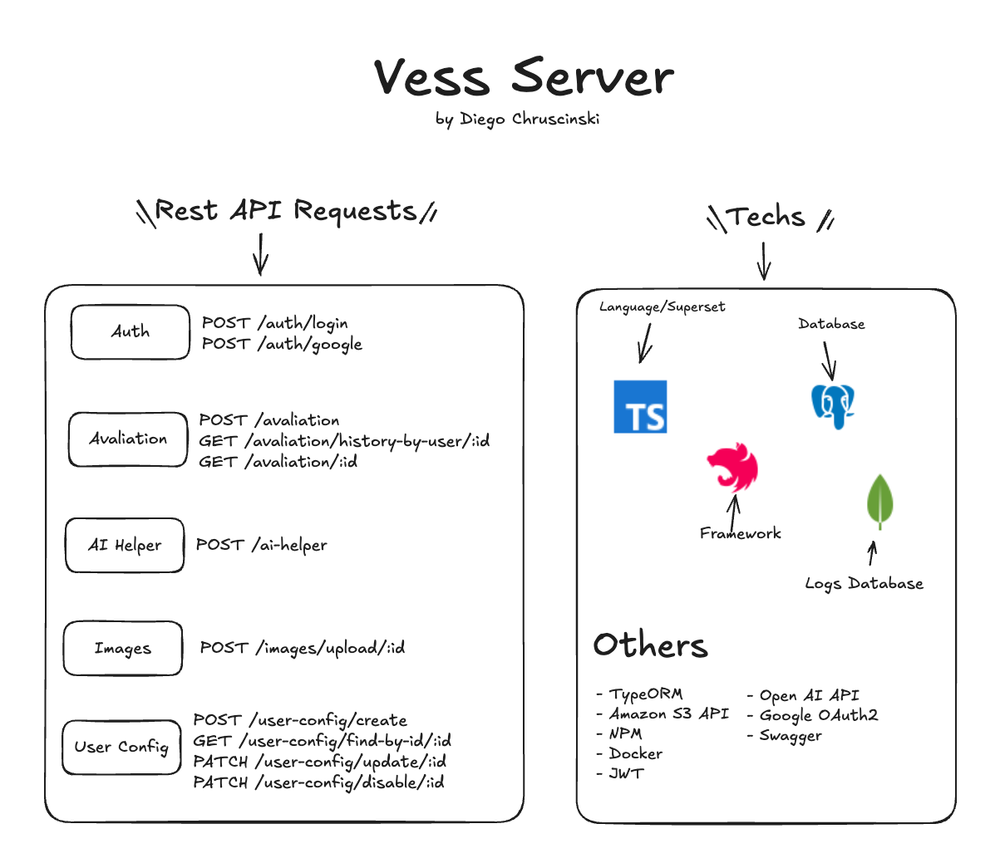

# VESS-SERVER 🚀

[](https://nestjs.com)
[](https://nodejs.org)
[](https://www.typescriptlang.org)
[](https://www.mongodb.com)
[](https://www.postgresql.org)
[](https://swagger.io)
[](https://aws.amazon.com/s3/)
[](https://openai.com)
[](https://github.com/features/actions)

## 📖 About

**VESS-SERVER** is an API built with [NestJS](https://nestjs.com) for the **Advanced Web Programming** course at UTFPR.  
Its main goal is to manage the registrations and operations required to calculate the **VESS method**, providing REST endpoints, secure authentication, and integrations with external services.

---

## Overview

<p align="center">
  
</p>

---

## ✨ Tech stack

- **Framework:** NestJS
- **Language:** TypeScript
- **Databases:** MongoDB and PostgreSQL
- **API Documentation:** Swagger (OpenAPI)
- **Integrations:**
  - OpenAI (ChatGPT)
  - Amazon S3 (file uploads)
- **Authentication:** JWT Bearer Token + Google OAuth2
- **CI/CD:** GitHub Actions

---

## 🚀 Key features

- User registration and authentication (**JWT + Google OAuth2**)
- VESS method resources management (CRUD and business rules)
- File upload and management via **Amazon S3**
- **OpenAI** integration to assist with AI-generated descriptions
- Auto-generated API docs with **Swagger**
- CI/CD pipelines with **GitHub Actions**

---

_Developed by Diego Chruscinski de Souza for the Advanced Web Programming course at UTFPR._

---

## Local setup

Requirements: Node.js, npm, Docker Compose, PostgreSQL and MongoDB. Google OAuth, S3 uploads and AI assistance also require credentials for their respective providers.

```bash
npm ci
cp .env.example .env
# Fill provider credentials and set local database passwords.
docker compose up -d
npm run start:dev
```

Database connection settings must match the Compose settings. The current MongoDB connection is assembled for localhost using MONGO_COMPOSE_* variables.

Swagger is served at /doc; the default application port is 3000. The frontend origin is configured as http://localhost:5173 in src/main.ts.

## Configuration notes

- JWT settings are read by the authentication configuration.
- Google OAuth needs a client ID, client secret and callback URL.
- S3 requires a region, bucket and credentials permitted to upload to that bucket.
- AI assistance uses the HTTP client configured in src/open-ai; verify the provider configuration and model availability before enabling it.
- TypeORM synchronize is enabled in the development configuration. Review it before deploying against persistent data.
- The MongoDB Compose service has an invalid TZ value that should be corrected before use.

## Available checks

```bash
npm run build
npm test
```

Tests that initialize application modules require the corresponding dependencies. The repository contains default NestJS tests and does not assert comprehensive coverage of the integrations. There is no LICENSE file in the repository.
